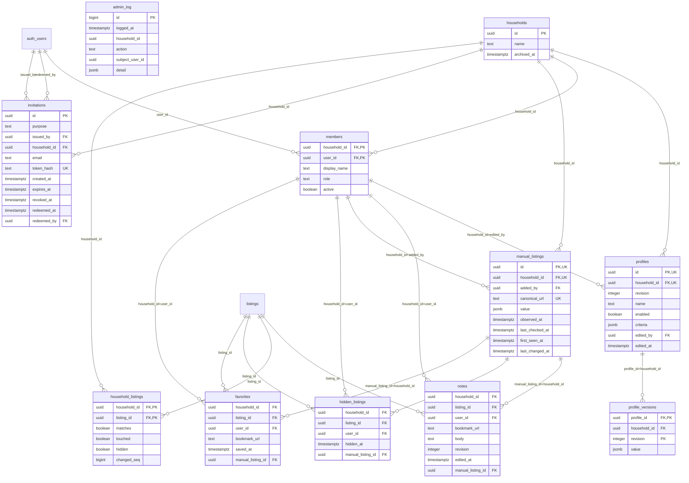
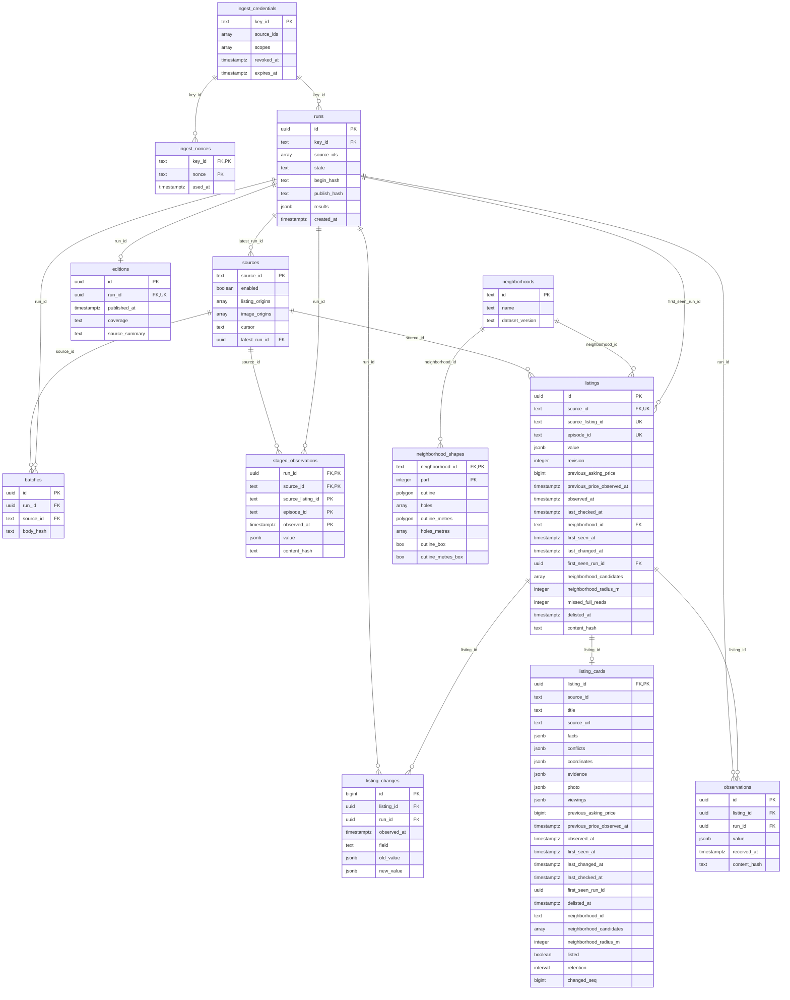

# House Scanner schema

The `hs` schema as the migrations in `supabase/migrations` build it, through
`20261022171317_house_scanner_location_mode.sql`. Read this before changing a table, a trigger or a `public.hs_*`
function, and update it in the same change. `instructions/house-scanner.md` has the operating rules.

- `hs` is not exposed through the API. Row-level security is on for every table, with no policies. The app, the
  Edge Functions and the collector reach the data only through `public.hs_*` functions, which are `security definer`
  and check membership or the ingest key themselves.
- 24 tables in five areas: households and people; search profiles; member marks (favorites, hides, notes, manual
  homes); the catalog and its ingest pipeline; and the read model that the snapshot reads.
- To check that this page is current, compare its tables and columns with
  `select table_name, column_name, data_type from information_schema.columns where table_schema='hs' order by 1, ordinal_position;`
  on a PGlite database built from all migrations (as the tests in `supabase/tests` do) or on hosted.

## Areas

`profiles.criteria.geography.mode` is optional: `municipalities` matches the
selected municipality names; `radius` matches the saved center and radius.
Missing mode keeps the earlier municipality-or-radius behavior. The client
applies geography; the database still returns candidates using its hard rules.
`hs.valid_criteria` validates the optional mode before applying the existing
strict checks. The migration changes no profile values or grants. Deploy the
client before allowing profiles to save the new field.

| Area | Tables | Written by | Read by |
| --- | --- | --- | --- |
| Households and people | `households`, `members`, `invitations`, `admin_log` | onboarding and settings functions (`hs_invitation_*`, `hs_household_*`, `hs_member_*`) | every member function checks `members`; `admin_log` is for the owner only |
| Search profiles | `profiles`, `profile_versions` | `hs_save_profile` (each save keeps the old version) | the read-model triggers, the snapshot |
| Member marks | `favorites`, `hidden_listings`, `notes`, `manual_listings` | `hs_set_favorite(s)`, `hs_set_hidden`, `hs_save_note`, `hs_add_manual`, `hs_update_manual`, `hs_delete_manual` | the snapshot |
| Catalog and ingest | `sources`, `source_policies_archive`, `ingest_credentials`, `ingest_nonces`, `runs`, `batches`, `staged_observations`, `editions`, `listings`, `listing_changes`, `observations`, `neighborhoods`, `neighborhood_shapes` | `hs_ingest` (called by the `house-scanner-ingest` Edge Function for the collector), operator policy changes | the read-model triggers |
| Read model | `listing_cards`, `household_listings` | triggers only, never written directly | `hs_household_snapshot`, `hs_household_start` |

## Households, people and member marks

`listings` and `auth_users` (Supabase `auth.users`) are shown only as references here; `listings` is detailed in the
catalog diagram.

- A member is a `(household_id, user_id)` pair. Profiles, marks and manual homes reference that pair, so a row can only
  belong to someone who is a member of the same household.
- `favorites`, `hidden_listings` and `notes` point at either a catalog home (`listing_id`) or a household's own manual
  home (`manual_listing_id`, together with `household_id`). A check constraint requires exactly one of the two.
- `invitations.purpose` is `create` (a new household, no `household_id`) or `join` (an existing household, with an
  email). Only the token's hash is stored.
- `admin_log` has no foreign keys on purpose, so the history outlives what it names. It holds no emails, secrets or
  criteria.
- `household_listings` belongs to the read model below.

## Catalog, ingest and read model

- A collector run is `runs` (state `staging`, then `published` or `failed`). Each request body is recorded once in
  `batches`, keyed by its hash, so a retried request is not applied twice. `ingest_nonces` stops replays.
- Observations wait in `staged_observations` until publish. Publish upserts `listings`, records field-level changes
  in `listing_changes`, and writes one `editions` row for the run.
- `listings.value` is the source's JSON as the ingest contract defines it (facts, coordinates, photo, evidence,
  viewings). One home on one source is `(source_id, source_listing_id, episode_id)`; a relisting is a new episode.
- `observations` is legacy: publish wrote full copies there until 22 October 2026. It is read-only now, replaced by
  `listing_changes`, and due to be dropped.
- `sources` holds each source's on/off switch (`enabled`) and the hosts its listings and images may come from.
  `latest_run_id` is kept by a trigger on `runs`. `hs.admin_set_source` adds a source or switches one. The policies
  they replaced are kept in `source_policies_archive` for the rollback of 20261023150000.
- `neighborhood_shapes` stores each area's polygons in degrees and in metres, with bounding boxes for the GiST
  pre-filter. A trigger assigns `listings.neighborhood_id` and the candidates when coordinates change.

## How the read model stays current

`listing_cards` holds one card per listing, keeping only what its source's hosts allow. `household_listings` holds, per household, each listing it
could see and why: `matches` (passes an enabled profile's hard rules), `touched` (favorited or noted) and `hidden`.
Both tables are derived. Never write them directly.

| Change | Trigger | Effect |
| --- | --- | --- |
| `listings` insert or update | `listing_cards_insert`, `listing_cards_update` | rebuild the changed cards |
| `sources` hosts change | `source_cards` | rebuild that source's cards |
| `listing_cards` insert or update | `card_households_insert`, `card_households_update` | re-match those listings for every household |
| `profiles` change | `profile_households` | re-match that household |
| `favorites`, `notes`, `hidden_listings` change | `favorite_households`, `note_households`, `hide_households` | update `touched` and `hidden` |
| `runs` publish (`staging` to `published`) | `expire_household_listings`, `mark_delisted`, `record_latest_run` | remove rows past retention that nobody saved, noted or hid; mark delistings and relistings with the run that decided them; record the source's latest run |

- The card triggers run once per statement over its transition table, so a publish refreshes in a few set-based
  statements. The profile and mark triggers run per row. All of them write a row only when it differs.
- Manual homes have no rows in either table; the snapshot reads them from `manual_listings`.
- `changed_seq` on both tables stamps each change. Nothing reads it yet; it is there for sending only what changed.
- Rules that depend on the clock stay in the snapshot query, not in the stored rows: retention, photo expiry, when
  coordinates and evidence were observed, viewing start times, and whether the source is switched on. Retention is
  14 days for every source (`hs.retention()`).
- `hs.card_drift()` and `hs.household_drift()` compare the stored rows with a fresh computation. Both must return
  nothing after any migration or data repair that touches these tables.

## Entry points

All are `public.hs_*` functions; the tables are never queried directly by a client.

| Caller | Functions |
| --- | --- |
| Signed-in member (`authenticated`) | `hs_household_start`, `hs_household_snapshot`, `hs_memberships`, `hs_household_access`, `hs_set_favorite`, `hs_set_favorites`, `hs_set_hidden`, `hs_save_note`, `hs_save_profile`, `hs_add_manual`, `hs_update_manual`, `hs_delete_manual`, `hs_household_rename`, `hs_household_leave`, `hs_member_make_owner`, `hs_member_deactivate`, `hs_invitation_create`, `hs_invitation_preview`, `hs_invitation_redeem`, `hs_invitation_revoke` |
| Edge Functions (`service_role`) | `hs_ingest`, `hs_ingest_credential`, `hs_ingest_sources`, `hs_consume_nonce`, `hs_invitation_reserve` |

The operator's `hs.admin_*` functions are not granted to any API role; the owner runs them from the SQL editor.

Migration 20261023150017_house_scanner_eight_photos raises hs.assert_observation to accept a lead photo plus seven additional photos (eight total), with a separate floor plan. Its rollback restores the four-photo ingest limit without deleting stored galleries. Redeploy the ingest Edge Function before the migration and update the collector after it. The app already accepts up to ten photos.
